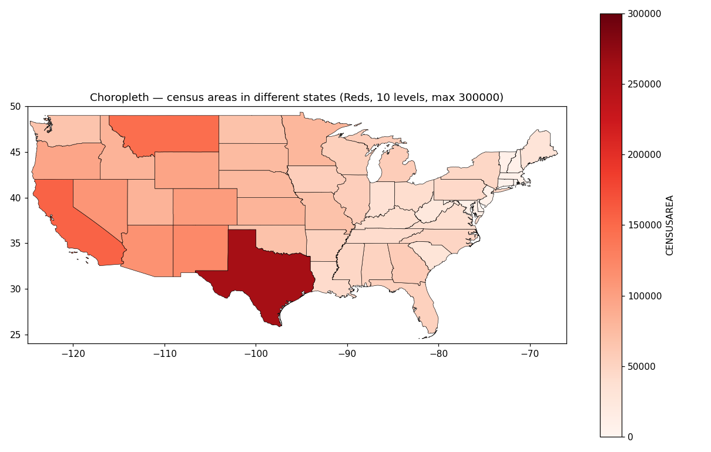
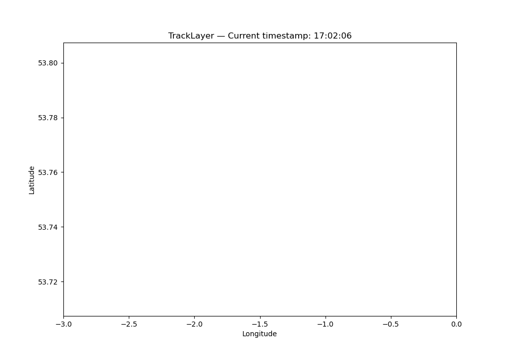

# LI YINGFANG — Data Science Portfolio

Hi! I am LI YINGFANG, a master's student at the University of Macau (CISC7204 Data Visualization). I enjoy turning raw data into clear, readable pictures — geospatial maps, statistical charts, and interactive visualizations.

## Technical Skills

- **Languages & tools:** Python, Git/GitHub, Jupyter Notebook
- **Data:** Pandas, NumPy, SciPy
- **Visualization:** Matplotlib, animation, choropleth / Voronoi / dot-density maps
- **Currently learning:** interactive mapping, dashboard design, NLP applications

## Project Showcase

### Geospatial Data Visualization with Python

**Research question:** How can Python be used to explore and communicate patterns in geospatial data — flight tracks, city point clouds, and administrative boundaries?

*US state outline map rendered with Matplotlib, used as the base layer for regional analysis.*

*Animated flight tracks: a sample of recorded positions shown over time, exported as a GIF.*

**Findings:** The project builds a reproducible pipeline (Pandas → SciPy Voronoi → Matplotlib) that renders point-density maps, choropleths, Voronoi tessellations, and track animations from flight and city data. It also exposed a classic data-quality trap: case-sensitive filtering silently returned zero matches on an all-lowercase city-name column, fixed by normalizing case before filtering.

- **Project repository:** [github.com/lyf200262-um/data-science-project](https://github.com/lyf200262-um/data-science-project)
- **Status:** Completed (ongoing refinements planned — interactive filtering and dashboard-style layers)

## Contact

- GitHub: [lyf200262-um](https://github.com/lyf200262-um)
